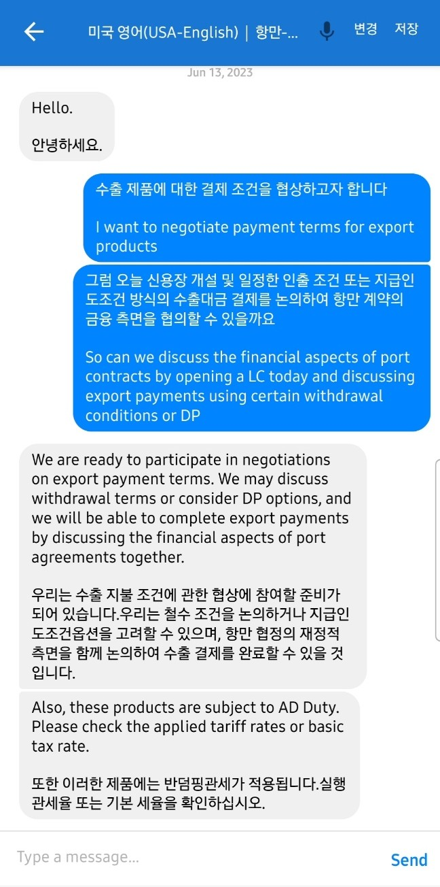
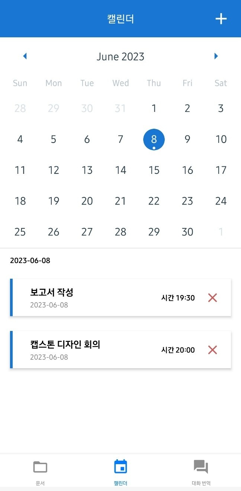
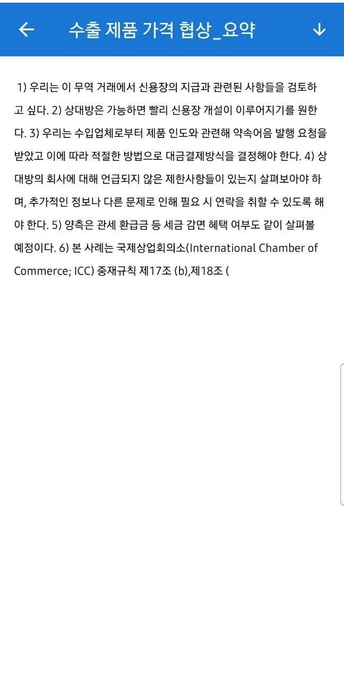

# TransMate

> 전문용어 데이터와 AWS Translate를 연동한 실시간 번역 서비스

[](https://github.com/minjuko/transmate/actions/workflows/ci.yml)

TransMate는 전남대학교 소프트웨어공학과 캡스톤디자인에서 3명이 함께 만든 모바일 번역 서비스입니다.

공공 전문용어 데이터를 정제해 **SW·금융·항만/무역** 분야의 AWS Translate Custom Terminology를 구축하고, 모바일 번역·회의록 기능을 Spring Boot API와 연결했습니다.

저는 **전문용어 데이터셋 구축과 AWS EC2 기반 실행 환경 구성**을 주도했으며, Spring Boot API와 AWS Translate·Custom Terminology 연동에 공동 참여했습니다.

## 프로젝트 개요

| 항목 | 내용 |
| --- | --- |
| 기간 | 2023.03.02–2023.06.15 |
| 유형 | 전남대학교 소프트웨어공학과 캡스톤디자인 |
| 인원 | 3명 |
| 지원 분야 | SW · 금융 · 항만/무역 |
| 본인 역할 | 전문용어 데이터 · AWS 실행 환경 · 번역 연동(공동) |
| 결과 | 캡스톤디자인 최종 발표 · 졸업논문 |
| 배포 | 프로젝트 당시 AWS EC2에 Spring Boot 백엔드 배포 완료 |

## 주요 기능 및 화면

<table>
  <tr>
    <th width="50%">전문용어 번역</th>
    <th width="50%">회의록 관리</th>
  </tr>
  <tr>
    <td align="center"></td>
    <td align="center"></td>
  </tr>
  <tr>
    <th>일정 관리</th>
    <th>회의 내용 요약</th>
  </tr>
  <tr>
    <td align="center"></td>
    <td align="center"></td>
  </tr>
</table>

### 주요 기능

| 기능 | 설명 |
| --- | --- |
| 음성·텍스트 번역 | STT 또는 텍스트로 입력한 내용을 설정한 언어로 번역 |
| 전문용어 번역 | 선택 분야의 Custom Terminology를 적용해 전문용어를 반영 |
| 회의록 관리 | 번역 대화를 회의 단위로 저장하고 조회 |
| 회의 내용 요약 | 저장된 회의 내용을 Kakao KoGPT로 요약 |
| PDF 다운로드 | 회의 기록과 요약 결과를 PDF로 생성·다운로드 |
| 일정 관리 | 회의 일정을 등록하고 관리 |

## 기술 스택

> 아래 기술은 프로젝트 전체 구성 기준입니다. 개인 구현 범위는 **본인 담당 및 기여** 섹션을 따릅니다.

| 영역 | 기술 |
| --- | --- |
| Mobile | React Native 0.71.8 · React Navigation · GiftedChat |
| Backend | Java 17 · Spring Boot 3.0.6 · Spring Data JPA |
| Database | H2 · Flyway · Firestore |
| Authentication | Firebase Authentication |
| Translation | AWS Translate · Custom Terminology |
| Infrastructure | AWS EC2 |
| Test·Quality | JUnit · Jest · ESLint · GitHub Actions |

모바일 실행환경과 Firebase·STT 설정은 [Mobile README](mobile/README.md)에서 확인할 수 있습니다.

## 담당 역할 및 핵심 구현

- **전문용어 데이터:** 공공 전문용어를 수집·정제하고 SW·금융·항만/무역 분야의 AWS Translate Custom Terminology를 구성했습니다. *(주도)*
- **AWS 실행 환경:** EC2에서 Spring Boot 백엔드 실행 환경과 배포를 구성했습니다. *(주도)*
- **번역 API 연동:** 모바일·백엔드·AWS Translate 간 요청·응답 및 전문용어 후처리 기능 구현에 참여했습니다. *(공동)*
- **검증 체계:** 백엔드 테스트, 모바일 테스트와 GitHub Actions CI를 정리했습니다.

## 트러블슈팅

### 전문용어 번역 결과의 누락 값 처리

- **문제:** AWS Translate 응답의 적용 전문용어에 번역어가 비어 있거나 없는 경우 후처리에서 예외 처리가 필요했습니다.
- **원인:** 전문용어 적용 결과가 항상 유효한 번역어를 포함한다고 가정한 처리 흐름이었습니다.
- **해결:** 번역어가 비어 있으면 추가 번역 요청을 수행하지 않고 최초 번역 결과를 유지하도록 처리했습니다.
- **검증:** 해당 예외 응답을 백엔드 회귀 테스트에 추가했습니다.

## 시작하기 (Getting Started)

백엔드 로컬 실행 및 모바일 환경·Firebase·STT 설정은 [Mobile README](mobile/README.md)와 저장소의 실행 설정을 참고해 주세요.

```bash
# 백엔드 테스트
cd backend
./gradlew clean test

# 모바일 테스트
cd ../mobile
npm ci
npm test -- --runInBand
npm run lint
```

## 테스트 및 코드 품질

| 항목 | 결과 |
| --- | --- |
| Backend 테스트 | **56건 통과** |
| Backend 빌드 | 통과 |
| Mobile 테스트 | **16건 통과** |
| Mobile ESLint | 통과 |
| GitHub Actions | Backend·Mobile 자동 검증 |

> 자동화 테스트 결과와 실제 모바일 네이티브 빌드·외부 번역 서비스 실행은 별개입니다. 현재 Android 네이티브 빌드는 의존성 호환성 문제로 통과하지 않아, 실행환경 재현 시 추가 작업이 필요합니다.

## 산출물 및 관련 문서

| 문서 | 내용 |
| --- | --- |
| [Mobile README](mobile/README.md) | 모바일 실행환경과 Firebase·STT 설정 |

